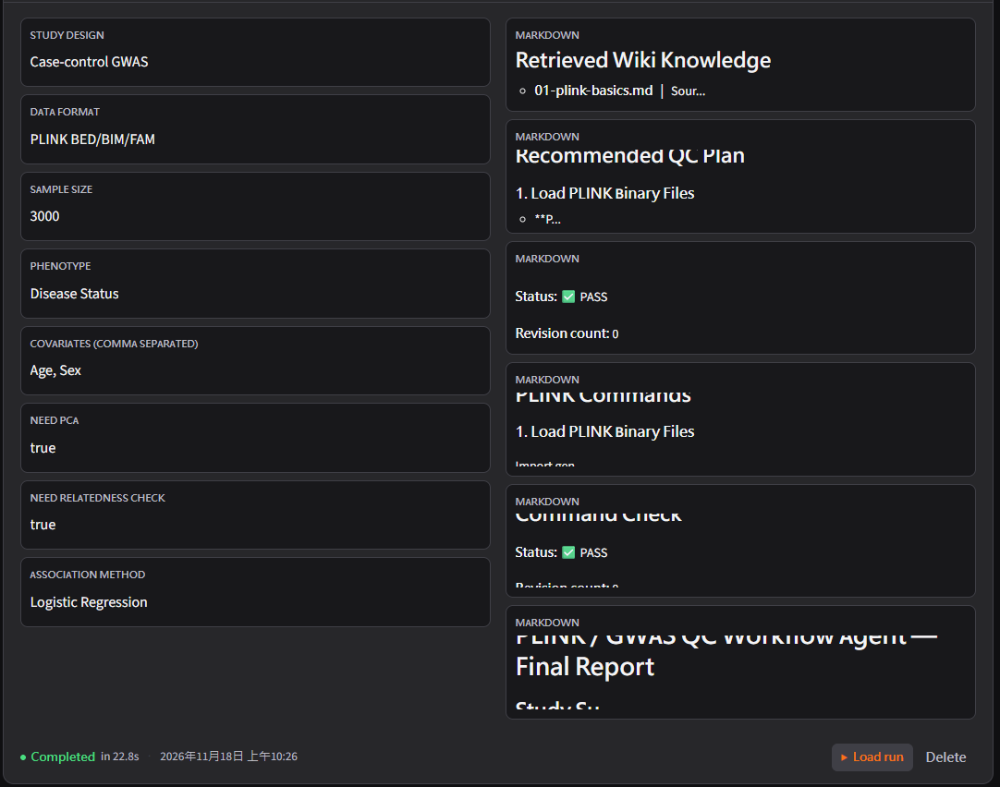

# Case A — PCA + Relatedness

## Input

- Study design: Case-control GWAS
- Data format: PLINK BED/BIM/FAM
- Sample size: 3000
- Phenotype: Disease Status
- Covariates: Age, Sex
- Association method: Logistic Regression
- Need PCA: True
- Need Relatedness Check: True

## Expected workflow

`Load PLINK Binary Files → Variant Missingness → Sample Missingness → MAF Filtering → HWE Filtering → LD Pruning → Relatedness → PCA → Association Analysis`

## Actual result

- Plan Check: **PASS**
- Plan revisions: **0**
- Command Check: **PASS**
- Command revisions: **0**
- Workflow behavior: **consistent with the conditional workflow design**
- Recorded runtime: **22.8 s**
- Final result: **PASS**

## Evidence

## Interpretation

This case verifies that the Agent changes the QC workflow according to the PCA and Relatedness requirements instead of always returning one fixed template.
