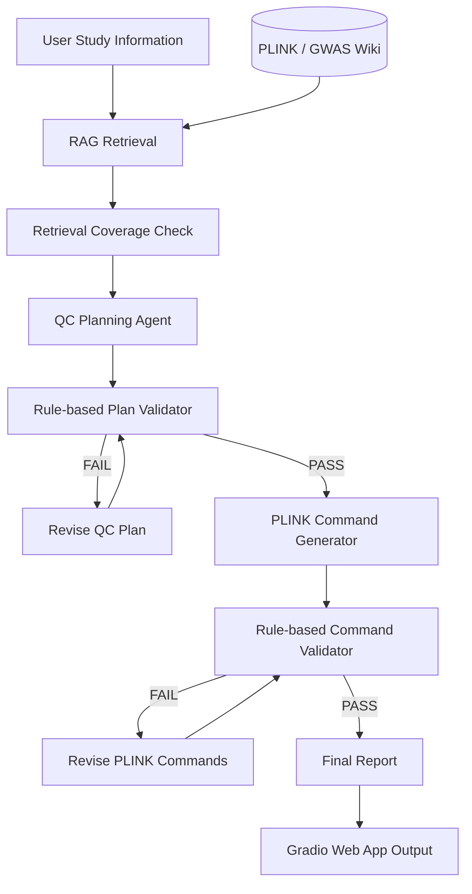

# PLINK / GWAS QC Workflow Agent — Graph

## Node responsibilities

- **RAG Retrieval**: retrieves relevant Wiki chapters and Source IDs.
- **Retrieval Coverage Check**: ensures study-required topics are present before planning.
- **QC Planning Agent**: creates a study-specific QC workflow.
- **Plan Validator**: checks required steps, ordering, source IDs, threshold wording, and LD-pruning logic.
- **Command Generator**: converts the verified QC plan into PLINK command examples.
- **Command Validator**: checks supported flags, parameter dependencies, association method, `--bfile`, `--out`, and misuse of LD-pruned data.
- **Revision nodes**: receive validator errors and regenerate only when needed.
- **Final Report**: summarizes the study settings, workflow, validation status, and knowledge sources.
